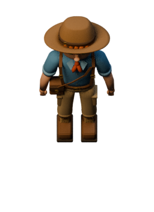
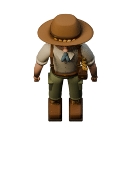

# Author evidence · independent review pending

These are proposed character masters for issue #57. Technical checks below are author checks; they do not replace independent Art QA or owner visual approval. The source baseline is `afece64170a46d01c0c4123f4ffd9084d4f671db`.

## Start with the actual renders

| Review | Evidence |
| --- | --- |
| Faces, clothing, hats, hair and pack construction | [Source portraits](source-face-details.png), [full-body neutral turnarounds](neutral-turnarounds.png) |
| Native four-direction identity, both characters/moods | [36px cells](native-facings-cell36.png), [48px cells](native-facings-cell48.png) |
| Exact exported 58° views | [256×352 body contact sheet](authoring-58-facings.png) |
| One-cell corridor, nearby fire and extinguisher | [36px south](corridor-south-cell36-pair.png), [48px north](corridor-north-cell48-pair.png) |
| Front/rear wall and corner layering | [48px front/rear](beforeBehind-south-cell48-pair.png), [36px west corner](corner-west-cell36-pair.png) |
| Mixed approved wall finishes / dense maze | [36px](maze-south-cell36-pair.png), [48px](maze-south-cell48-pair.png) |
| Equipment / painted tipi / worst-case same-anchor overlap | [Props](overlap-south-cell36-pair.png), [goal overlap](arrival-south-cell36-pair.png) |
| Actual phone-size page and scene crops | [390×844 page](390x844-cell36-review.png), [boy native crop](390x844-cell36-boy-daylight.png), [girl native crop](390x844-cell36-girl-daylight.png) |
| Alpha / grayscale / reduced effects | [Black](alpha-east-black.png), [white](alpha-east-white.png), [checker](alpha-east-checker.png), [grayscale](overlap-grayscale.png), [reduced](overlap-reduced-effects.png) |

Contact sheets retain the actual cell scale at DPR 1; labels/margins add canvas space. Device-frame captures retain the stated viewport/DPR. Image viewers may resize large sheets: open at 100% for a native judgment. The source portraits/neutral turnarounds use a separate labeled inspection camera and face fill; they are not gameplay projection evidence. All models, source/import comparisons and sprite views are real Blender renders of the committed geometry.

The blue/tan boy and cream/olive girl remain distinguishable from the front; the blonde braid and red hair provide secondary cues. Back/side silhouettes intentionally share field hats, packs and bedrolls. At 36px, hat/pack/clothing dominate and individual eyes/freckles are not reliably readable; the 58° brim hides most facial area. The evening rig reduces small clothing/hair differences further. Owner review must judge the intended storybook teenage appearance and whether these proposed lean proportions are satisfactory. Portrait detail does not establish native-scale face recognition.

The proposed height is **1.34235048 cells**, including the hat, versus the approved **.595-cell wall** (about **2.256×**). This is a measured proposal, not an approved production stature. Physical X/Y bounds fit inside a single cell; there is no collision/gameplay change. In the inspected scenes, ground paths and neighboring fire/extinguisher/tipi retain their positions and shapes. Worst-case same-anchor goal evidence intentionally reveals partial tipi occlusion; this fixture does not choose a production arrival policy. Foreground walls can cover boots under the existing row-based layer order. No outline, E badge or navigation cue was added to conceal an occlusion issue.

## Measured technical results

| Check | Result / record |
| --- | --- |
| Editable source and fixed projection | Both `.blend` sources reopen; feet roots/scales, source UVs, editable materials, explicit eye components, girl braid, canonical triangulation and all four camera fits pass [source audit](source-audit.json). No actions, armatures or animation. |
| Sprite contract | **16 bodies + 16 shadows**. Bodies 256×352 / anchor (128,208) / 224px per cell; shadows 256² / anchor (128,150) / 112px per cell. Same mesh fingerprint across each character's directions/moods. |
| Alpha and lighting | Every body has **20–37px** of fully transparent border. Every sprite outer edge has zero alpha; per-facing body alpha is identical in day/evening. RGB-only edge dilation passes. All shadow centroids remain upper-right of the feet anchor under the same approved light positions. |
| Declared shadow margin exceptions | For **each character**: north/daylight **11px**, west/daylight **12px**, west/evening **14px**. Six of sixteen shadows fall below the 15px target; entire soft tails are retained at the approved scale/anchor with clear edges. See [manifest](../manifest.json) `marginExceptions`. No tail clipping or extra thresholding was used to manufacture a 15px border. |
| PNG verification / isolation | All SHA-256 records, dimensions, anchors, bounds and dilation pass [validation](validation.json). Complete Batch 01/02, `src`, `public`, package files and `.github` remain byte-identical to the baseline. Only `docs/art/batch-03/**` is added. |
| Browser matrix | **64 viewport/facing cases**: 320×568, 390×844, 844×390, 1280×800; DPR 1/2; 36/48px cells; four facings. **48 fixture/facing cases**: six fixtures × two cell sizes × four facings. Both characters and moods are present in each case. All four approved wall finishes, alpha backgrounds, grayscale, reduced effects, synchronized native scrolling, no storage/animation/HTTP/page errors pass [browser report](browser.json). |
| Existing client suite | **159 tests / 13 suites passed**, [output](client-tests.txt); no runtime source edits. |
| Existing projection / new art fixtures | **3 + 3 tests passed**, [projection](projection-tests.txt), [fixtures](fixture-tests.txt). Projection output suppresses an unrelated existing Node module-type warning; no source/package change. |

## Portable models and clean reimport

| Model | Triangles | PBR groups | GLB bytes | SHA-256 |
| --- | ---: | ---: | ---: | --- |
| CHR-BOY-01 | 19,902 | 22 | 2,057,588 | `a563135560631ba001d719dc66ad90f26ccdc87c2fa82e54e41cb28935478dd4` |
| CHR-GIRL-01 | 21,874 | 22 | 2,092,456 | `3123b0125e900d284161014d0d5404f69fa9c32a0cbd0312afff4bba423cc4e1` |

Both GLBs embed 1024² base-color and tangent-normal PNGs, retain scalar metallic/roughness, and contain only one identity root and one mesh. They have no camera, light, ground, shadow receiver, skin or animation. Root feet pivot and one-unit cell scale survive glTF axis conversion. They are archival masters; 22 primitives and the unrigged topology are not a certified mobile/deforming runtime budget.

The audit factory-resets Blender, verifies the empty scene, copies **only the GLB** to an otherwise empty temporary directory and imports there. There is no source `.blend` or external texture file in the import directory. Both imported images are packed. Maximum bidirectional position discrepancy is **1.23×10⁻⁷ cell**. Minimum source/import normal dot is **.99999964 boy / .99999788 girl**. Bounds, triangle count, signed volume, surface area, winding, finite normalized/orthogonal tangents and UV range pass. Read the [boy](../characters/boy/evidence/glb-reimport.json) and [girl](../characters/girl/evidence/glb-reimport.json) reports.

| Actual paired render | Procedural source | Clean GLB import |
| --- | --- | --- |
| Boy · daylight |  |  |
| Girl · daylight |  |  |
| Boy · evening | [Source](../characters/boy/evidence/source-check-dusk.png) | [Import](../characters/boy/evidence/reimport-check-dusk.png) |
| Girl · evening | [Source](../characters/girl/evidence/source-check-dusk.png) | [Import](../characters/girl/evidence/reimport-check-dusk.png) |
| Boy · face inspection | [Source](../characters/boy/evidence/source-check-face.png) | [Import](../characters/boy/evidence/reimport-check-face.png) |
| Girl · face inspection | [Source](../characters/girl/evidence/source-check-face.png) | [Import](../characters/girl/evidence/reimport-check-face.png) |

Official-camera source/import silhouettes differ by **zero pixels** in all four paired mood comparisons. Mean absolute RGB8 error over visible source pixels is **.775 day / .517 evening boy**, **.862 day / .580 evening girl**; 95th-percentile channel error is 3 day / 2 evening. Local maximum channel error reaches **94** for the girl/day comparison: the small shader/atlas differences must not be represented as perfect color parity. PBR atlases approximate continuous procedural bump/color, and glTF core shading omits Blender-specific shader behavior. Fine iris/freckle detail and filtering can differ; editable originals stay in `.blend`. A second complete GLB/texture export was **byte-identical for all six files** in Blender 4.3.2: [repeat report](repeat-portable.json). Cross-platform bytes are not guaranteed.

## Gate and limits

**Stop for independent Art QA and owner visual approval.** Author recommendation is to review proportions, the simple facial sculpt/eye treatment, hat/pack scale, side/rear identity, dusk readability and the six declared shadow-margin exceptions before accepting this study. No character-selection flow, animation, runtime activation, gameplay changes, merge or deployment is included. No GitHub CI polling occurred.

The 32 PNG layers total **1,038,851 compressed bytes / 9.5 MiB decoded RGBA**; one character/facing/mood body+shadow pair is **.59375 MiB**. Each portable model's two RGBA8 1024² maps require about **8 MiB before mipmaps**, regardless of compressed GLB size. Device/GPU residency, real-phone perception, Safari/Firefox and accessibility testing are not certified. Ground seams and full vertical warm-light/atmosphere work remain deferred from the approved wall batches. Ground-only amber pools in the comparison page do not relight these characters.
