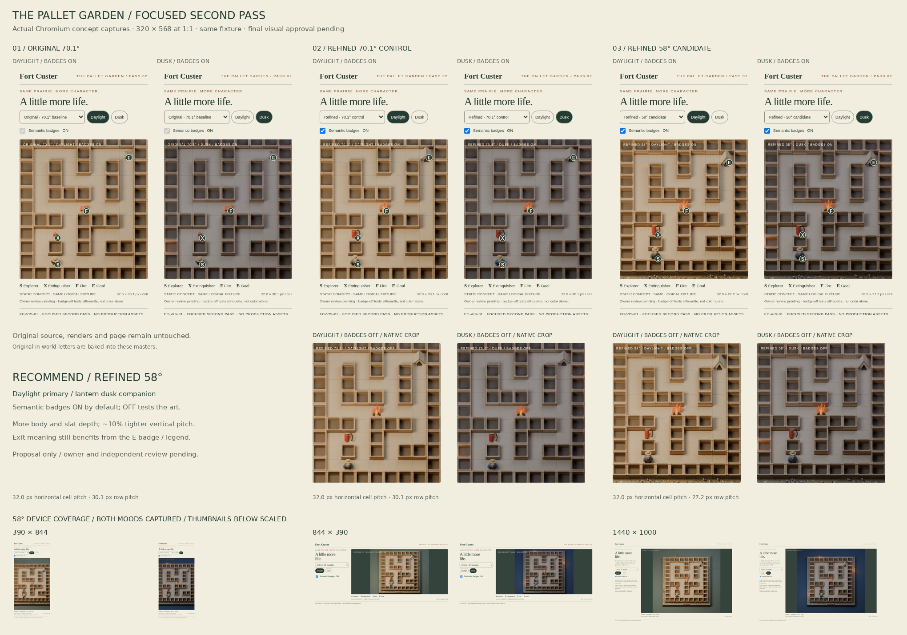

# The Pallet Garden — focused second pass (v0.2)

**Direction retained; final reference approval pending.** Updates existing [draft PR #38](https://github.com/MZKZxyz/fort-custer-client/pull/38) under the [owner's focused second-pass direction](https://github.com/MZKZxyz/fort-custer-client/issues/30#issuecomment-6390478720). The complete original v0.1 study, source, renders, page and evidence remain unchanged and are documented below.



[Interactive comparison page](iteration-2/index.html) · [Native silhouette / badge / grayscale sheet](iteration-2/previews/silhouette-sheet.jpg) · [Revised source](iteration-2/source/render.py) · [Contract deltas](asset-contract.md) · [New image/source hashes](iteration-2/manifest.json)

## Recommendation for owner review

Choose **refined 58° daylight** as the primary reference, with matching lantern dusk and **badges ON by default**. It reveals more clay character and pallet-slat depth while preserving continuous wall footprints; retain 70.1° as a clarity fallback. This is a recommendation, not final approval or a camera/art-bible lock.

Tradeoff: at 320 px, 58° compresses vertical ground pitch from 30.1 to 27.2 CSS px (about 10%). Tall flames, the hat and roof overlap neighboring wall tops in projection, even though their world X/Y bounds remain inside their own cells. No corridor-width false openings were observed in this authored fixture; other grids and runtime sorting still need Engineering/independent QA review. **Remaining ambiguity:** the goal clearly reads as a canvas structure, but “exit” is learned from the E badge/legend; its neutral fictional portrayal remains provisional for Narrative/owner review. Badge-off/grayscale evidence supports comparison, not a universal recognition or WCAG compliance claim.

## What changed / what stayed fixed

- Larger visible explorer body/pose, smaller rear-set hat, separate boots and front-facing nose; unchanged logical feet-center anchor. Extinguisher leans away from the camera to expose its cylinder, with a raised loop/nozzle. Fire has three raised tips and golden core. Goal is a wider neutral canvas A-frame with an actual entrance opening.
- All revised renders are badge-free masters. The page's optional 15 px S/X/F/E annotations are the only semantic letters in revised maze tiles. Original masters retain their original baked letters; the baseline cannot honestly be shown badge-free, so its OFF control is disabled.
- Revised 70.1° versus 58° uses **identical meshes, fixture, object positions, palette, cell units, lighting recipes and orthographic scale**. Wall-construction AST and logical fixture match v0.1. All original source/render/evidence bytes are checked against commit `a91847d`.
- Four revised 1400×1400 renders, 22 actual Chromium screenshots (native DPR 1), one main comparison sheet and one native target-crop sheet. No production rendering, physical-device testing, performance measurement or new gameplay is claimed.

## Device and occlusion evidence

The 58° candidate is captured in both moods with badges ON and OFF at every required size. The original and revised 70.1° controls are additionally captured at 320×568 for the A/B board. Full-size captures and actual DOM measurements are indexed in [browser-checks.json](iteration-2/previews/browser-checks.json); mesh/body cropping and visibility samples are joined in [framing-checks.json](iteration-2/previews/framing-checks.json).

| CSS viewport | Horizontal / vertical cell pitch | Framing |
|---|---|---|
| 320×568 | 32.02 / 27.16 px | Nine-column crop, native mobile evidence |
| 390×844 | 39.81 / 33.76 px | Nine-column crop with more vertical context |
| 844×390 | 25.17 / 21.35 px | Short landscape; complete fixture at smaller pitch |
| 1440×1000 | 55.94 / 47.44 px | Complete diorama and perimeter |

All 22 captures passed image/treatment/lighting/badge-state, keyboard activation, page-bounds and script-error checks with reduced motion requested. No target badge or conservative target-body bounds are cropped, and no sampled target point is wall-occluded at either revised angle. These are author checks, not independent signoff.

Finite parallel-ray samples check coat, face, both boots, cylinder, lever, nozzle, flame tips/core and ridge; the entrance sample passes through the open doorway. These author diagnostics do not replace independent perception or full-scene occlusion review. [Geometry checks](iteration-2/previews/geometry-checks.json) record every sample and [export bounds](iteration-2/previews/export-bounds.json) evaluate the proposed common body canvas; no transparent sprite or shadow export was produced.

## Reproduce the second pass

```sh
blender -b --threads 2 --python docs/art/reference-scene/iteration-2/source/render.py
blender -b --threads 2 /tmp/fort-custer-iteration-2.blend --python docs/art/reference-scene/iteration-2/source/audit.py
python3 -m http.server 8031 --bind 127.0.0.1 --directory docs/art/reference-scene
# In another terminal, from repository root:
node docs/art/reference-scene/iteration-2/source/capture.cjs
python3 docs/art/reference-scene/iteration-2/source/finish.py
```

Blender 4.3.2 / Cycles, 64 samples, no denoiser; existing Python/Pillow and Chromium tooling. `refine-cache.py` records the local shortcut used to regenerate X from the authoritative source in the temporary authoring cache; a clean `render.py` run builds the same revised geometry. No external artwork or paid image API. Original provenance applies. Review gates remain owner visual approval, Engineering projection/alpha/occlusion compatibility, independent QA perception/accessibility and Narrative goal portrayal. Rollback removes the second-pass directory and reverts the two documentation deltas; v0.1 remains available. No production files, dependencies, server, CI or deployment changes.

---

## Original v0.1 package (preserved)

# Fort Custer / The Pallet Garden

**FC-VIS-01 · Sprint 1 · study v0.1 · OWNER REVIEW PENDING**

An original, handmade miniature maze study for [issue #30](https://github.com/MZKZxyz/fort-custer-client/issues/30), including its [kickoff boundaries](https://github.com/MZKZxyz/fort-custer-client/issues/30#issuecomment-6390145293). Read against root `AGENTS.md`, approved OD-01/02/03/19/20/21 and the reconciliation map on refreshed main **`a9394631661a9e654bb3cb9b9e6dbce14b9491fa`**. Archived Art/UX drafts were consulted as context; their unapproved clauses are not new authority.

## Review the work


Open **[index.html](index.html)** locally for the keyboard-operable lighting comparison. It works as a standalone file, with local JPEGs and no network dependencies. These are **real offline Blender renders presented in a real Chromium page**, not the production renderer or a playable game. The browser captures below record the concept page at the stated CSS viewport dimensions, at device scale 1, with reduced motion requested.

| Treatment | Original render | 320×568 Chromium | 1440×1000 Chromium |
|---|---|---|---|
| Natural daylight | [1400×1400](renders/daylight.jpg) | [Native mobile capture](previews/mobile-daylight.jpg) | [Desktop capture](previews/desktop-daylight.jpg) |
| Lantern dusk | [1400×1400](renders/dusk.jpg) | [Native mobile capture](previews/mobile-dusk.jpg) | [Desktop capture](previews/desktop-dusk.jpg) |

Also review [daylight detail](previews/daylight-detail.jpg), the [literal collision footprint diagram](previews/collision-plan.svg), [proposed asset contract](asset-contract.md), [browser observations](previews/browser-checks.json), [author checks](previews/art-checks.json) and [image hashes](manifest.json). The contact sheet's grayscale insets are derived from the actual mobile screenshots. The collision diagram is a labeled logical diagnostic, not a render.

## Art direction and geometry

Quiet ochre corridors, honey-colored horizontal slats, deep hollow wells, small indigo clay explorer and restrained violet prairie flowers. Broad hat, feet and backpack establish the explorer's silhouette. X is a cylinder with hose and squeeze lever; F is a group of pointed sculpted flame tongues; E is a small canvas tent with a dark triangular opening. Pale S/X/F/E medallions add redundant identification in both renders. The browser review enlarges those letters as high-contrast 15 px annotations at the same projected anchors for native phone legibility; these annotations are part of the concept page, not runtime UI.

Every blocked cell has a full continuous footing. Hollow wells stay inside that blocked footprint; adjoining cubes share an edge without a walkable gap. Grasses, flowers, pebbles, lanterns and the optional fictional field plaque remain outside the logical maze. All paths receive the same ground treatment. Dusk keeps the entire viewport visible with cool ambient light and subordinate amber practicals; the lanterns do not mark a route. No fog, particles, depth-of-field, shake or animation is used.

One authored **9-column × 11-row static fixture** is used in both moods. This is a deliberately small representative composition, not a claim that a full daily maze fits on a phone. The mobile image crop preserves ~32 px cells / nine visible columns at 320 px. Desktop reveals the complete diorama with its perimeter. Responsive follow/clamp behavior belongs to VIS-03. Only one explorer pose is authored; four-direction production sprites and alpha exports are deferred.

## Local reproduction

Requires Blender 4.3+, Python 3/Pillow, the repository's existing `@playwright/test`, and Chromium at `/usr/bin/chromium`. No package or production build changes are needed.

```sh
# From repository root; authoring may take several minutes.
blender -b --python docs/art/reference-scene/source/render.py
python3 docs/art/reference-scene/source/finish.py --prepare
python3 -m http.server 8030 --directory docs/art/reference-scene
# In another terminal, from repository root:
node docs/art/reference-scene/source/capture.cjs
python3 docs/art/reference-scene/source/finish.py
```

`--prepare` encodes the rendered PNGs into high-quality review JPEGs and removes intermediate PNGs. `capture.cjs` exercises both treatment buttons by keyboard, checks decoded images, horizontal overflow and JavaScript errors, and writes the four screenshots. `finish.py` checks fixture connectivity/token counts and four UI contrast pairs, generates the logical plan/contact sheet/detail crop, and hashes the evidence. Small CPU/platform differences can alter render hashes; deterministic scene parameters are recorded in source.

## Evidence and limits

Local results (2026-10-24): both 1400×1400 Cycles renders completed at 64 samples without denoising; all four Chromium captures passed image loading, keyboard activation/pressed state, page bounds, label bounds and script-error checks. All 43 path cells are connected and S/X/F/E occur once each. UI contrast pairs measure 10.18:1, 5.55:1, 5.80:1 and 11.26:1. Source syntax, evidence hashes, local links and staged whitespace checks passed. `git apply --reverse --check --cached` passed against the staged binary patch, demonstrating a reversible prototype-only change. Production paths match pinned main; full app/CI suites were not run for this isolated art deliverable.

The provided JSON files report actual local author checks, not independent acceptance. UI token contrast is measured separately from artistic texture contrast. Grayscale views support owner/QA perception review; they do not certify color-vision or scene-wide WCAG compliance. The review page has accessible button names, pressed states, focus indication, descriptive alt text and no required motion. It is not evidence of accessible gameplay, touch controls, screen-reader navigation, DOM sprite occlusion, runtime FPS, real-phone performance, or production regression testing.

Owner visual approval, Engineering anchor/export consult, independent QA-01 review and Narrative review of the provisional goal remain **pending**. The canvas silhouette is intentionally provisional, preserving the current compact tent-like goal direction without asserting historical authenticity or changing existing assets. Reference images mentioned in archived drafts were not supplied; no claim is made to have seen or matched them.

## Review ownership and rollback

Art author owns the study and recommendations. Final visual approver: repository owner **MZKZxyz**. Requested review roles: VIS-02 Engineering for logical center/scale mapping, integrator for migration boundary, independent QA-01 for small-scale and accessibility perception, Narrative for goal portrayal. This is a draft for review, not Ready or owner-approved.

All added files are under **`docs/art/reference-scene/**`**. Revert the single publication commit or remove this directory to roll back. Nothing imports the study into the app, and it replaces no production asset. The publication tree is based on current main and adds only this directory; no server, gameplay, dependency, CI, deployment or production data change is included. Do not merge or promote the contract before the required reviews.

## Provenance

All meshes, materials, lights and composition were procedurally authored in the included Python source for this task. No external artwork, stock images, production art copies, reference-image tracing or paid image API was used. Blender's bundled text outlines produce the tiny in-world marks; the review page uses local system fonts. The contact sheet uses the installed DejaVu font only for captions. Blender/Pillow/Chromium are authoring tools, not runtime dependencies. No independent third-party art license is needed for the generated geometry; contribution rights remain governed by repository terms. No historical factual claim or cultural endorsement is implied.
