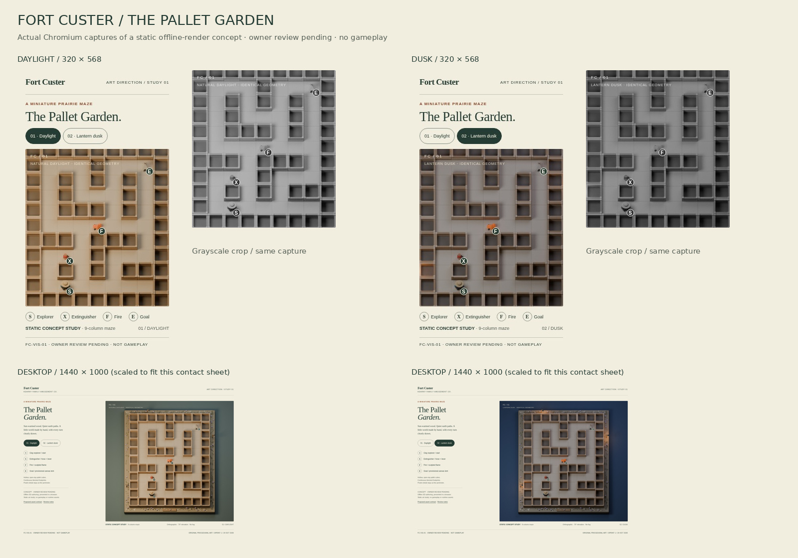

# Fort Custer / The Pallet Garden

**FC-VIS-01 · Sprint 1 · study v0.1 · OWNER REVIEW PENDING**

An original, handmade miniature maze study for [issue #30](https://github.com/MZKZxyz/fort-custer-client/issues/30), including its [kickoff boundaries](https://github.com/MZKZxyz/fort-custer-client/issues/30#issuecomment-6390145293). Read against root `AGENTS.md`, approved OD-01/02/03/19/20/21 and the reconciliation map on refreshed main **`a9394631661a9e654bb3cb9b9e6dbce14b9491fa`**. Archived Art/UX drafts were consulted as context; their unapproved clauses are not new authority.

## Review the work



Open **[index.html](index.html)** locally for the keyboard-operable lighting comparison. It works as a standalone file, with local JPEGs and no network dependencies. These are **real offline Blender renders presented in a real Chromium page**, not the production renderer or a playable game. The browser captures below record the concept page at the stated CSS viewport dimensions, at device scale 1, with reduced motion requested.

| Treatment | Original render | 320×568 Chromium | 1440×1000 Chromium |
|---|---|---|---|
| Natural daylight | [1400×1400](renders/daylight.jpg) | [Native mobile capture](previews/mobile-daylight.jpg) | [Desktop capture](previews/desktop-daylight.jpg) |
| Lantern dusk | [1400×1400](renders/dusk.jpg) | [Native mobile capture](previews/mobile-dusk.jpg) | [Desktop capture](previews/desktop-dusk.jpg) |

Also review [daylight detail](previews/daylight-detail.jpg), the [literal collision footprint diagram](previews/collision-plan.svg), [proposed asset contract](asset-contract.md), [browser observations](previews/browser-checks.json), [author checks](previews/art-checks.json) and [image hashes](manifest.json). The contact sheet's grayscale insets are derived from the actual mobile screenshots. The collision diagram is a labeled logical diagnostic, not a render.

## Art direction and geometry

Quiet ochre corridors, honey-colored horizontal slats, deep hollow wells, small indigo clay explorer and restrained violet prairie flowers. Broad hat, feet and backpack establish the explorer's silhouette. X is a cylinder with hose and squeeze lever; F is a group of pointed sculpted flame tongues; E is a small canvas tent with a dark triangular opening. Pale S/X/F/E medallions add redundant identification in both renders. The browser review enlarges those letters as high-contrast 15 px annotations at the same projected anchors for native phone legibility; these annotations are part of the concept page, not runtime UI.

Every blocked cell has a full continuous footing. Hollow wells stay inside that blocked footprint; adjoining cubes share an edge without a walkable gap. Grasses, flowers, pebbles, lanterns and the optional fictional field plaque remain outside the logical maze. All paths receive the same ground treatment. Dusk keeps the entire viewport visible with cool ambient light and subordinate amber practicals; the lanterns do not mark a route. No fog, particles, depth-of-field, shake or animation is used.

One authored **9-column × 11-row static fixture** is used in both moods. This is a deliberately small representative composition, not a claim that a full daily maze fits on a phone. The mobile image crop preserves ~32 px cells / nine visible columns at 320 px. Desktop reveals the complete diorama with its perimeter. Responsive follow/clamp behavior belongs to VIS-03. Only one explorer pose is authored; four-direction production sprites and alpha exports are deferred.

## Local reproduction

Requires Blender 4.3+, Python 3/Pillow, the repository's existing `@playwright/test`, and Chromium at `/usr/bin/chromium`. No package or production build changes are needed.

```sh
# From repository root; authoring may take several minutes.
blender -b --python docs/art/reference-scene/source/render.py
python3 docs/art/reference-scene/source/finish.py --prepare
python3 -m http.server 8030 --directory docs/art/reference-scene
# In another terminal, from repository root:
node docs/art/reference-scene/source/capture.cjs
python3 docs/art/reference-scene/source/finish.py
```

`--prepare` encodes the rendered PNGs into high-quality review JPEGs and removes intermediate PNGs. `capture.cjs` exercises both treatment buttons by keyboard, checks decoded images, horizontal overflow and JavaScript errors, and writes the four screenshots. `finish.py` checks fixture connectivity/token counts and four UI contrast pairs, generates the logical plan/contact sheet/detail crop, and hashes the evidence. Small CPU/platform differences can alter render hashes; deterministic scene parameters are recorded in source.

## Evidence and limits

Local results (2026-10-24): both 1400×1400 Cycles renders completed at 64 samples without denoising; all four Chromium captures passed image loading, keyboard activation/pressed state, page bounds, label bounds and script-error checks. All 43 path cells are connected and S/X/F/E occur once each. UI contrast pairs measure 10.18:1, 5.55:1, 5.80:1 and 11.26:1. Source syntax, evidence hashes, local links and staged whitespace checks passed. `git apply --reverse --check --cached` passed against the staged binary patch, demonstrating a reversible prototype-only change. Production paths match pinned main; full app/CI suites were not run for this isolated art deliverable.

The provided JSON files report actual local author checks, not independent acceptance. UI token contrast is measured separately from artistic texture contrast. Grayscale views support owner/QA perception review; they do not certify color-vision or scene-wide WCAG compliance. The review page has accessible button names, pressed states, focus indication, descriptive alt text and no required motion. It is not evidence of accessible gameplay, touch controls, screen-reader navigation, DOM sprite occlusion, runtime FPS, real-phone performance, or production regression testing.

Owner visual approval, Engineering anchor/export consult, independent QA-01 review and Narrative review of the provisional goal remain **pending**. The canvas silhouette is intentionally provisional, preserving the current compact tent-like goal direction without asserting historical authenticity or changing existing assets. Reference images mentioned in archived drafts were not supplied; no claim is made to have seen or matched them.

## Review ownership and rollback

Art author owns the study and recommendations. Final visual approver: repository owner **MZKZxyz**. Requested review roles: VIS-02 Engineering for logical center/scale mapping, integrator for migration boundary, independent QA-01 for small-scale and accessibility perception, Narrative for goal portrayal. This is a draft for review, not Ready or owner-approved.

All added files are under **`docs/art/reference-scene/**`**. Revert the single publication commit or remove this directory to roll back. Nothing imports the study into the app, and it replaces no production asset. The publication tree is based on current main and adds only this directory; no server, gameplay, dependency, CI, deployment or production data change is included. Do not merge or promote the contract before the required reviews.

## Provenance

All meshes, materials, lights and composition were procedurally authored in the included Python source for this task. No external artwork, stock images, production art copies, reference-image tracing or paid image API was used. Blender's bundled text outlines produce the tiny in-world marks; the review page uses local system fonts. The contact sheet uses the installed DejaVu font only for captions. Blender/Pillow/Chromium are authoring tools, not runtime dependencies. No independent third-party art license is needed for the generated geometry; contribution rights remain governed by repository terms. No historical factual claim or cultural endorsement is implied.
