# Sprint 1.5B — opt-in client playable sessions

Sprint 1.5D follow-up: [accepted-result arrival focus and focused revalidation](result-arrival.md). The original evidence below remains tied to its recorded source hashes.

Tracks [client #47](https://github.com/MZKZxyz/fort-custer-client/issues/47) and [server #9](https://github.com/MZKZxyz/fort-custer-server/issues/9). Client baseline: `9467af75ce730811d2911e4d05a1707ce4c5cbc4`. Frozen server runtime: `f33ce52a86ffccae5c28c661ce560ff783a9b836`; actual disposable harness [server PR #10](https://github.com/MZKZxyz/fort-custer-server/pull/10) at `2db3820468bba805a32d20c07f2e586b0819d6ec`. The exact [server contract](server-contract.json) is copied unchanged from that revision; the separate protocol fixtures use synthetic values. See [protocol fixtures](protocol-fixtures.json), [source/evidence hashes and results](validation.json), and [offline actual-server replay results](differential-results.json). Exact implementation SHA is reported on the draft PR and issue.

**Release remains OFF.** No environment, CI, deployment, server runtime, database or production setting changed. This is author validation, not independent QA or release approval. The published disposable server harness was subsequently available and the compiled client passed **10/10 actual authenticated HTTP/Mongo/browser tests**, including stored result/grant/inventory/outbox assertions. These author results are distinct from fixture-browser tests; Sprint 1.5C independent QA remains required.

## Implementation and preserved behavior

`src/session/contract.js` is the only v2 HTTP adapter. It captures the original authorization token rather than using the v1 interceptor's mutable token, supplies the exact protocol headers, and handles capability/create/ready/status/result/recover/complete/abandon. The existing v1 adapter and its start/complete payloads, result storage and session-storage retry identity are unchanged.

`PlayableSession` owns the durable attempt, pinned manifest, ordered canonical prefix, replay checkpoint and immutable completion. `SessionGate` holds an exclusive Web Lock for the mounted v2 attempt and renders recovery instead of replacing an unresolved attempt. The existing `MazePage.movePlayer` pairs ONE `{seq,dir}` with its existing pure `move()` result, saves that pair synchronously, then applies visual/state effects. Walls and unarmed fire are recorded even though they keep the same state; stationary clearing is recorded separately from the fresh command that enters. Rejected pre-ACK/modal/terminal input, pointer samples, renderer updates and undispatched held ticks are not recorded.

No movement/controller/coordinator/steering/camera/scene/CSS/renderer implementation changed. The approved 400ms/180ms scheduler, 8° hysteresis, 48px trailing anchor, bounded anticipated turns, full-maze pointer capture, scoped pinch-zoom touch behavior, collision pause/redirection, stationary fire, one-charge kit, fog, geometry and one tipi remain canonical. Help/Controls keep their focus behavior and cancel movement; optional direction buttons remain initially hidden and locally remembered. The integrated renderer remains separately OFF and its fallback preserves v2 state/prefix/identity.

## Admission and ready latch

V2 requires literal `REACT_APP_EXPERIMENTAL_SESSION_V2=true` in an isolated/local build **and** authenticated capabilities `{protocol:'session-v2', capabilities:['route-transcript-v1'], admission:true}`. A false/missing protocol/capability/admission or definitive capability 404/426 chooses legacy only before creating any durable v2 intent. Capability network errors, authentication errors and unresolved operations show recovery; they never cause a speculative create or implicit downgrade.

An existing v1 completion recovery precedes new v2 admission. Any stored v2 attempt takes precedence over new starts, even in a flag-OFF build: that build displays instructions to reopen the original experimental build and issues no v2 or v1 request. No UI toggle enables v2 in a default build.

```mermaid
stateDiagram-v2
    [*] --> Negotiate
    Negotiate --> Legacy: no v2 capability/admission, no prior intent
    Negotiate --> Creating: opt-in + admission; persist original keys
    Creating --> Prepared: create ACK or original create-key replay
    Prepared --> AwaitingACK: pinned grid rendered, assets settled, coordinator bound
    AwaitingACK --> Playing: durable ready ACK or owned STARTED status
    Playing --> Completing: persist terminal command + frozen transcript
    Completing --> Accepted: owned immutable receipt
    Creating --> Recovery: ambiguous response
    AwaitingACK --> Recovery: lost ACK
    Playing --> Recovery: interruption/storage/scope/expiry
    Completing --> Recovery: unknown commit
    Recovery --> Playing: owned status + verified replay + ACK latch
    Recovery --> Completing: result/recover proves retry is permitted
    Recovery --> Accepted: saved result wins
    Recovery --> Terminal: explicit abandon ACK / owned expiry
    Terminal --> Negotiate: explicit restart
```



Ready is issued after the actual maze surface is mounted, its images settle and the existing coordinator is bound. No command or timer starts before the durable server ACK. Resource waits are bounded at 15 seconds of visible animation time and re-read the current render host so fallback cannot leave a wait attached to removed images. Browser-hidden time is not a pause entitlement.

The HUD stays provisional. At ACK/resume it estimates elapsed from `Date.now() - server.startedAt`, then advances monotonically using `performance.now()`. Local clock offset/manipulation can affect that estimate; it cannot supply the receipt time. The server charges ready-commit/ACK overhead and completion ingress; there is no RTT compensation. An accepted untimed receipt displays **Accepted untimed completion**, accepted date progression and the allowlisted collectible disposition. It writes neither legacy `lastMazeTime` nor `bestTimes`. Official milliseconds appear only when the receipt explicitly says `official`; no v2 leaderboard is introduced.

## Durable scope and recovery

Local keys are `fc.session-v2.attempt.v1` and `fc.session-v2.receipt.v1`. The versioned record binds account identity digest, profile/date, random 192-bit create/ready/complete/abandon keys, attempt ID, SHA-256 grid/manifest pin, server session, command prefix, replay checkpoint and phase. No new copy of the JWT is stored. JWT payload identity is only a local scope hint: actual authentication/ownership always belongs to the server. A changed token during input cancels; a renewed JWT for the same account can recover through fresh owned reads. Opaque tokens are exact-bound.

Every command checkpoint is saved before UI advancement; the terminal command also freezes `{version:'route-transcript-v1',commands}` before any completion HTTP request. Storage writes are checked for success and for unexpected concurrent changes. Storage denial/quota failure stops before an unrecorded state change. The server's 65,536-command / 2,097,152-byte transcript limits are checked without truncation (the command format is ASCII, so JSON character/UTF-8 byte lengths agree). Browser quota can impose an earlier visible stop, especially at terminal payload persistence. Nothing promises maximal-length performance on physical phones.

Restoration fetches the owned original session, verifies its supported manifest and original grid hash/pin, replays the saved canonical prefix from S, and compares the entire local checkpoint before resuming. Local replay detects inconsistent storage, not malicious coherent edits; legal-route validation does not prove live human input. Missing/corrupt prefix cannot fabricate a scene. Explicit abandonment requires an owned terminal status or guarded server ACK. An unresolved completion must be resolved rather than discarded.

| Failure point | Recovery behavior / assertion |
| --- | --- |
| Create committed before ACK | Same saved create key is replayed; no capability renegotiation, new key or v1 start |
| Ready committed before ACK | Owned STARTED status retains original start; no optimistic new start |
| Refresh after pickup/clear | Original pinned grid + exact prefix reconstruct kit, removed items/fire, position and fog inputs |
| Before completion POST | Terminal command already persisted frozen transcript/key; refresh submits original operation |
| Durable intake / unknown commit | Read result; a 503/empty result is not abort proof; use owned `/recover` before resubmission |
| Resolver returns aborted/no-pending | Refresh owned revision as needed, replay and resend only the identical transcript/key |
| Final result committed before lost ACK | Recover immutable receipt with no additional complete request |
| Late ACK after cancellation | Operation epoch rejects the stale callback before it can overwrite state/receipt or re-enable movement |
| StrictMode / two tabs | Discarded effect does not acquire a lock; one mounted owner, competing tab makes no commands/start |
| Scope/token/date change | Stop and require original account/profile/date; foreign selectors do not rebind attempt |
| Offline / blur / visibility / resize / pagehide | Existing coordinator cancels gestures; offline enters recovery; no movement/timing catch-up |
| Local/server deadline | Stop conservatively; fetch owned effective state; explicit terminal release only |
| Storage/prefix lost | Keep identifiers where available; review or guarded abandonment. Total browser-storage deletion cannot recover a lost create key through this API |

One unresolved v2 record per origin is deliberately conservative: another profile/date is blocked until the original is resolved. Web Locks and Web Crypto require a supported secure context; unsupported browsers fail closed before create. Closing a tab releases its lock but retains durable progress. Refresh does not pause server time. Do not clear browser storage to fix an unresolved save.

Receipt UI admits only protocol/date, timing disposition/milliseconds, known collectible statuses and bounded text fields (`name`, `description`, `emoji`, `category`, `rarity`). Private IDs, messages, raw objects, image URLs, transcripts and clock evidence are not rendered. Accepted local receipts are cached display data, not ranking or authentication authority.

## Repeat local validation

Node 24, installed dependencies and Chromium are required. Commands below use ignored relative build directories, not deployment settings. Run browser suites separately because the static host owns loopback port 3101. All synthetic browser requests are intercepted by the declared fixture unless using the separately described actual-service runner.

```sh
CI=true npm test -- --watchAll=false --runInBand
REACT_APP_MAZE_VISUAL_INTEGRATION=true CI=true npm test -- --watchAll=false --runInBand

# Default production-like classic. No v2/visual/camera/preview activation.
REACT_APP_EXPERIMENTAL_SESSION_V2=false REACT_APP_MAZE_VISUAL_INTEGRATION=false REACT_APP_MAZE_CAMERA=false REACT_APP_MAZE_INPUT_PREVIEW=false REACT_APP_API_URL=/api BUILD_PATH=.temp/v1 npm run build
FC_BUILD_DIR=.temp/v1 FC_V2_EXPECT_OFF=true npx playwright test --config=docs/client-v2/playwright.config.cjs
FC_BUILD_DIR=.temp/v1 npx playwright test --config=docs/unified-input/playwright.config.cjs

# Isolated v2 classic build; does not enable the production server.
REACT_APP_EXPERIMENTAL_SESSION_V2=true REACT_APP_MAZE_VISUAL_INTEGRATION=false REACT_APP_MAZE_CAMERA=false REACT_APP_MAZE_INPUT_PREVIEW=false REACT_APP_API_URL=/api BUILD_PATH=.temp/v2 npm run build
FC_BUILD_DIR=.temp/v2 FC_V2_EVIDENCE=.temp/v2-evidence npx playwright test --config=docs/client-v2/playwright.config.cjs

# Supplementary opt-in renderer/fallback only.
REACT_APP_EXPERIMENTAL_SESSION_V2=true REACT_APP_MAZE_VISUAL_INTEGRATION=true REACT_APP_MAZE_CAMERA=false REACT_APP_MAZE_INPUT_PREVIEW=false REACT_APP_API_URL=/api BUILD_PATH=.temp/v2-integrated npm run build
FC_BUILD_DIR=.temp/v2-integrated REACT_APP_MAZE_VISUAL_INTEGRATION=true npx playwright test --config=docs/client-v2/playwright.config.cjs --grep 'integrated v2 renderer'

# Adjacent server checkout must contain the frozen replay source. No DB or HTTP.
FC_SERVER_ROOT=../fort-custer-server node docs/client-v2/differential.mjs

git diff --check
```

Author results and screenshots are inventoried in [validation.json](validation.json). Default and integrated unit suites: **158 passing each**. Offline differential against the actual merged server replay: **104/104**, 69,354 commands, including a 65,536-command transcript (1,627,352 bytes). It compares grid, position, equipment, completion and normalized transcript digest; it does not exercise authentication, transactions, clock authority or grant storage.

Compiled opt-in classic: **13 passing**, 3 mode-specific skips. Default-only contract checks: **2 passing**, 14 mode-specific skips. Integrated v2 fallback: **1 passing**. Opposite-mode tests are explicit skips, never retried or silently filtered after failures. Full legacy input regressions: **64 passing, 26 explicit flag/input-specific skips** (90 cases); exact totals are recorded in validation.json. All local browser runs use Linux Chromium with mobile/CDP emulation, not physical iOS Safari, iOS PWA, Android Chrome/PWA, screen-reader speech or monitored clock evidence.

Development corrections: the first build caught an unsupported lint global and an unused import; both were corrected. A sandbox-local listener initially lacked network permission; browser validation was rerun with local network access. The differential initially used an unnecessary git subprocess unsupported in the restricted runner; it now checks the frozen replay source's SHA-256 directly. Focused lifecycle review added StrictMode lock and stale-ready-ACK regression tests. No final gameplay failure is suppressed by retries. Actual-service startup/barrier corrections are documented below.

## Actual disposable-server validation and handoff

Pinned server harness: `2db3820468bba805a32d20c07f2e586b0819d6ec`, [server PR #10](https://github.com/MZKZxyz/fort-custer-server/pull/10). Node 24 and MongoDB **8.0.16** are required. The server's `spawnIntegration` owns a temporary loopback replica set, two actual application workers, synthetic users/profiles/catalog and private fault/restart controls. No production entrypoint, external database, migration or seeder was used. Runtime bootstrap tokens and raw snapshots stay private; actual-browser tracing is disabled.

From the client checkout with an adjacent server checkout at that pin and installed server dependencies:

```sh
# MONGOD_BINARY selects the local MongoDB 8.0.16 executable, never a DB URI.
env -u MONGO_URI -u MONGODB_URI -u MONGO_URL -u DATABASE_URL FC_SERVER_ROOT=../fort-custer-server FC_BUILD_DIR=.temp/v2 FC_V2_ACTUAL_EVIDENCE=.temp/actual-evidence npx playwright test --config=docs/client-v2/playwright.actual.config.cjs
```

**10 passing, zero failures/skips/retries**: four actual compiled-classic viewport cases at 320×568, 390×844, 844×390 and 1280×800; lost create, ready and final ACK; durable intake crash/restart and identical completion retry; two-tab recovery, same-date replay and next-date exhaustion; storage denial before admission. The matrix tests native mouse/CDP touch, keyboard and optional D-pad, Help focus/cancellation, pre-ACK input/timer lockout, fire clearing without entry, refresh after clear, saving and accepted untimed receipts.

API responses are forwarded unchanged over actual loopback HTTP through a browser test proxy. There are no fabricated successful API replies. This exercises the client recorder and real JWT/ownership/services/transactions, but does not certify direct cross-origin browser CORS behavior or physical network fairness. Server contract/source SHA-256 pins and fixture hashes are checked. Disposable raw snapshots verify one immutable result for the original attempt, accepted date progress, one date grant, unchanged legacy time map, inventory `integration-compass:1`, settled grant outbox and one receipt event. The crash case verifies pending intake with no winner before restart and the same transcript/key on retry. Same-date replay adds a result without another grant; the next date exhausts the one-item catalog with inventory still one.

Initial actual-suite startup failed because disposable disk space was below MongoDB's minimum; obsolete generated build artifacts were removed and the unchanged server checks passed. The first gameplay run had **8 pass / 2 test-barrier failures**: a prior fault's hit flag was observed before the current ready request was armed. The barrier now waits for the current fault's arm acknowledgment before checking its hit state. All readiness, command, receipt and storage assertions remain; the final run is **10/10**. No client/server gameplay or protocol fix was needed for these harness issues.

These are author integration results. Independent Sprint 1.5C should replay the checked-in matrix and extend direct CORS, browser interruption, physical mobile/PWA, clock/expiry, resource exhaustion and server restart scenarios. Multi-member durability, monitored timing, live writer cutover and production fairness are not certified.

## QA playtest and limitations

At each target size, start the isolated v2 classic build. Before ready ACK press arrows: position/prefix/timer stay frozen. After ACK test Help focus/escape, Controls and remembered buttons, drag from maze edges/sprites, blocked wall steering and consecutive corners. Walk down/right/right/up to test unarmed fire, then left/up for the extinguisher; right clears in place, held steering must stop, a fresh right enters and another right reaches the tipi. Refresh after the clear, then repeat with lost save ACK and offline recovery. No extra complete may follow completion or receipt refresh. Repeat through opt-in integrated fallback without changing prefix/identity.

Small Help dialogs scroll; keyboard Escape remains available, and no global scroll/zoom rule changed. Screenshots use the existing offline fallback font and small synthetic grid. Physical-device zoom, screen readers, long-prefix storage latency/quota and resource-exhaustion behavior remain QA work. No first-play tutorial, broad art change, new power/progression/scoring policy, public v2 leaderboard, monitored official clock or production activation is included. EG-01/02/03/05, EG-08/09/11 and server #5/#7 release gates remain open; this integration supplies no independent signoff.

## Reversible rollback

1. Stop new admission in the **disposable test harness** and close extra game tabs. Preserve original keys, transcript, receipts and server tombstones.
2. An opt-in build can still recover owned admitted sessions/results while new admission is OFF; explicitly resolve completion or obtain abandon/expiry proof. Do not replace an unresolved attempt with v1 or erase its storage.
3. Returning to a build with the experimental flag absent/false preserves v1 for new users and keeps the durable v2 guard for affected test origins. Reopen the original isolated build if a pending attempt needs recovery.
4. Revert this cohesive implementation commit only after every affected isolated origin has resolved its v2 attempts. A full source revert removes that guard, so reverting before draining is unsafe. Preserve old legacy completion recovery data throughout. No data migration, record rewrite, deployment or live setting change is part of rollback.

Independent cross-repository QA and owner review are required before any later release decision. Do not merge, deploy, activate production flags or poll CI as part of this task.

## Screenshot gallery

Each link has a matching full-page and viewport capture. These are the compiled production-style shell with synthetic server-shaped responses; they are not the UX study or physical-device evidence.

### 320x568

| State | Viewport | Full page |
| --- | --- | --- |
| ready | [view](evidence/320x568-ready-window.png) | [page](evidence/320x568-ready-page.png) |
| playing | [view](evidence/320x568-playing-window.png) | [page](evidence/320x568-playing-page.png) |
| help | [view](evidence/320x568-help-window.png) | [page](evidence/320x568-help-page.png) |
| directions | [view](evidence/320x568-directions-window.png) | [page](evidence/320x568-directions-page.png) |
| blocked-fire | [view](evidence/320x568-blocked-fire-window.png) | [page](evidence/320x568-blocked-fire-page.png) |
| kit | [view](evidence/320x568-kit-window.png) | [page](evidence/320x568-kit-page.png) |
| fire-cleared | [view](evidence/320x568-fire-cleared-window.png) | [page](evidence/320x568-fire-cleared-page.png) |
| prefix-recovery | [view](evidence/320x568-prefix-recovery-window.png) | [page](evidence/320x568-prefix-recovery-page.png) |
| saving | [view](evidence/320x568-saving-window.png) | [page](evidence/320x568-saving-page.png) |
| save-error | [view](evidence/320x568-save-error-window.png) | [page](evidence/320x568-save-error-page.png) |
| accepted-untimed | [view](evidence/320x568-accepted-untimed-window.png) | [page](evidence/320x568-accepted-untimed-page.png) |

### 390x844

| State | Viewport | Full page |
| --- | --- | --- |
| ready | [view](evidence/390x844-ready-window.png) | [page](evidence/390x844-ready-page.png) |
| playing | [view](evidence/390x844-playing-window.png) | [page](evidence/390x844-playing-page.png) |
| help | [view](evidence/390x844-help-window.png) | [page](evidence/390x844-help-page.png) |
| directions | [view](evidence/390x844-directions-window.png) | [page](evidence/390x844-directions-page.png) |
| blocked-fire | [view](evidence/390x844-blocked-fire-window.png) | [page](evidence/390x844-blocked-fire-page.png) |
| kit | [view](evidence/390x844-kit-window.png) | [page](evidence/390x844-kit-page.png) |
| fire-cleared | [view](evidence/390x844-fire-cleared-window.png) | [page](evidence/390x844-fire-cleared-page.png) |
| prefix-recovery | [view](evidence/390x844-prefix-recovery-window.png) | [page](evidence/390x844-prefix-recovery-page.png) |
| saving | [view](evidence/390x844-saving-window.png) | [page](evidence/390x844-saving-page.png) |
| save-error | [view](evidence/390x844-save-error-window.png) | [page](evidence/390x844-save-error-page.png) |
| accepted-untimed | [view](evidence/390x844-accepted-untimed-window.png) | [page](evidence/390x844-accepted-untimed-page.png) |

### 844x390

| State | Viewport | Full page |
| --- | --- | --- |
| ready | [view](evidence/844x390-ready-window.png) | [page](evidence/844x390-ready-page.png) |
| playing | [view](evidence/844x390-playing-window.png) | [page](evidence/844x390-playing-page.png) |
| help | [view](evidence/844x390-help-window.png) | [page](evidence/844x390-help-page.png) |
| directions | [view](evidence/844x390-directions-window.png) | [page](evidence/844x390-directions-page.png) |
| blocked-fire | [view](evidence/844x390-blocked-fire-window.png) | [page](evidence/844x390-blocked-fire-page.png) |
| kit | [view](evidence/844x390-kit-window.png) | [page](evidence/844x390-kit-page.png) |
| fire-cleared | [view](evidence/844x390-fire-cleared-window.png) | [page](evidence/844x390-fire-cleared-page.png) |
| prefix-recovery | [view](evidence/844x390-prefix-recovery-window.png) | [page](evidence/844x390-prefix-recovery-page.png) |
| saving | [view](evidence/844x390-saving-window.png) | [page](evidence/844x390-saving-page.png) |
| save-error | [view](evidence/844x390-save-error-window.png) | [page](evidence/844x390-save-error-page.png) |
| accepted-untimed | [view](evidence/844x390-accepted-untimed-window.png) | [page](evidence/844x390-accepted-untimed-page.png) |

### 1280x800

| State | Viewport | Full page |
| --- | --- | --- |
| ready | [view](evidence/1280x800-ready-window.png) | [page](evidence/1280x800-ready-page.png) |
| playing | [view](evidence/1280x800-playing-window.png) | [page](evidence/1280x800-playing-page.png) |
| help | [view](evidence/1280x800-help-window.png) | [page](evidence/1280x800-help-page.png) |
| directions | [view](evidence/1280x800-directions-window.png) | [page](evidence/1280x800-directions-page.png) |
| blocked-fire | [view](evidence/1280x800-blocked-fire-window.png) | [page](evidence/1280x800-blocked-fire-page.png) |
| kit | [view](evidence/1280x800-kit-window.png) | [page](evidence/1280x800-kit-page.png) |
| fire-cleared | [view](evidence/1280x800-fire-cleared-window.png) | [page](evidence/1280x800-fire-cleared-page.png) |
| prefix-recovery | [view](evidence/1280x800-prefix-recovery-window.png) | [page](evidence/1280x800-prefix-recovery-page.png) |
| saving | [view](evidence/1280x800-saving-window.png) | [page](evidence/1280x800-saving-page.png) |
| save-error | [view](evidence/1280x800-save-error-window.png) | [page](evidence/1280x800-save-error-page.png) |
| accepted-untimed | [view](evidence/1280x800-accepted-untimed-window.png) | [page](evidence/1280x800-accepted-untimed-page.png) |

Supplementary opt-in renderer: [fire clear](evidence/integrated-fire-cleared-window.png), [full page](evidence/integrated-fire-cleared-page.png); [classic fallback](evidence/integrated-classic-fallback-window.png), [full page](evidence/integrated-classic-fallback-page.png).

## Actual-service screenshots

These captures use the real authenticated disposable server and compiled classic client, separately from the synthetic fixture gallery above.

### 320x568 actual HTTP/Mongo

| State | Viewport | Full page |
| --- | --- | --- |
| ready | [view](actual-evidence/320x568-actual-ready-window.png) | [page](actual-evidence/320x568-actual-ready-page.png) |
| playing | [view](actual-evidence/320x568-actual-playing-window.png) | [page](actual-evidence/320x568-actual-playing-page.png) |
| help | [view](actual-evidence/320x568-actual-help-window.png) | [page](actual-evidence/320x568-actual-help-page.png) |
| directions | [view](actual-evidence/320x568-actual-directions-window.png) | [page](actual-evidence/320x568-actual-directions-page.png) |
| blocked-fire | [view](actual-evidence/320x568-actual-blocked-fire-window.png) | [page](actual-evidence/320x568-actual-blocked-fire-page.png) |
| kit | [view](actual-evidence/320x568-actual-kit-window.png) | [page](actual-evidence/320x568-actual-kit-page.png) |
| fire-cleared | [view](actual-evidence/320x568-actual-fire-cleared-window.png) | [page](actual-evidence/320x568-actual-fire-cleared-page.png) |
| prefix-recovery | [view](actual-evidence/320x568-actual-prefix-recovery-window.png) | [page](actual-evidence/320x568-actual-prefix-recovery-page.png) |
| saving | [view](actual-evidence/320x568-actual-saving-window.png) | [page](actual-evidence/320x568-actual-saving-page.png) |
| accepted | [view](actual-evidence/320x568-actual-accepted-window.png) | [page](actual-evidence/320x568-actual-accepted-page.png) |

### 390x844 actual HTTP/Mongo

| State | Viewport | Full page |
| --- | --- | --- |
| ready | [view](actual-evidence/390x844-actual-ready-window.png) | [page](actual-evidence/390x844-actual-ready-page.png) |
| playing | [view](actual-evidence/390x844-actual-playing-window.png) | [page](actual-evidence/390x844-actual-playing-page.png) |
| help | [view](actual-evidence/390x844-actual-help-window.png) | [page](actual-evidence/390x844-actual-help-page.png) |
| directions | [view](actual-evidence/390x844-actual-directions-window.png) | [page](actual-evidence/390x844-actual-directions-page.png) |
| blocked-fire | [view](actual-evidence/390x844-actual-blocked-fire-window.png) | [page](actual-evidence/390x844-actual-blocked-fire-page.png) |
| kit | [view](actual-evidence/390x844-actual-kit-window.png) | [page](actual-evidence/390x844-actual-kit-page.png) |
| fire-cleared | [view](actual-evidence/390x844-actual-fire-cleared-window.png) | [page](actual-evidence/390x844-actual-fire-cleared-page.png) |
| prefix-recovery | [view](actual-evidence/390x844-actual-prefix-recovery-window.png) | [page](actual-evidence/390x844-actual-prefix-recovery-page.png) |
| saving | [view](actual-evidence/390x844-actual-saving-window.png) | [page](actual-evidence/390x844-actual-saving-page.png) |
| accepted | [view](actual-evidence/390x844-actual-accepted-window.png) | [page](actual-evidence/390x844-actual-accepted-page.png) |

### 844x390 actual HTTP/Mongo

| State | Viewport | Full page |
| --- | --- | --- |
| ready | [view](actual-evidence/844x390-actual-ready-window.png) | [page](actual-evidence/844x390-actual-ready-page.png) |
| playing | [view](actual-evidence/844x390-actual-playing-window.png) | [page](actual-evidence/844x390-actual-playing-page.png) |
| help | [view](actual-evidence/844x390-actual-help-window.png) | [page](actual-evidence/844x390-actual-help-page.png) |
| directions | [view](actual-evidence/844x390-actual-directions-window.png) | [page](actual-evidence/844x390-actual-directions-page.png) |
| blocked-fire | [view](actual-evidence/844x390-actual-blocked-fire-window.png) | [page](actual-evidence/844x390-actual-blocked-fire-page.png) |
| kit | [view](actual-evidence/844x390-actual-kit-window.png) | [page](actual-evidence/844x390-actual-kit-page.png) |
| fire-cleared | [view](actual-evidence/844x390-actual-fire-cleared-window.png) | [page](actual-evidence/844x390-actual-fire-cleared-page.png) |
| prefix-recovery | [view](actual-evidence/844x390-actual-prefix-recovery-window.png) | [page](actual-evidence/844x390-actual-prefix-recovery-page.png) |
| saving | [view](actual-evidence/844x390-actual-saving-window.png) | [page](actual-evidence/844x390-actual-saving-page.png) |
| accepted | [view](actual-evidence/844x390-actual-accepted-window.png) | [page](actual-evidence/844x390-actual-accepted-page.png) |

### 1280x800 actual HTTP/Mongo

| State | Viewport | Full page |
| --- | --- | --- |
| ready | [view](actual-evidence/1280x800-actual-ready-window.png) | [page](actual-evidence/1280x800-actual-ready-page.png) |
| playing | [view](actual-evidence/1280x800-actual-playing-window.png) | [page](actual-evidence/1280x800-actual-playing-page.png) |
| help | [view](actual-evidence/1280x800-actual-help-window.png) | [page](actual-evidence/1280x800-actual-help-page.png) |
| directions | [view](actual-evidence/1280x800-actual-directions-window.png) | [page](actual-evidence/1280x800-actual-directions-page.png) |
| blocked-fire | [view](actual-evidence/1280x800-actual-blocked-fire-window.png) | [page](actual-evidence/1280x800-actual-blocked-fire-page.png) |
| kit | [view](actual-evidence/1280x800-actual-kit-window.png) | [page](actual-evidence/1280x800-actual-kit-page.png) |
| fire-cleared | [view](actual-evidence/1280x800-actual-fire-cleared-window.png) | [page](actual-evidence/1280x800-actual-fire-cleared-page.png) |
| prefix-recovery | [view](actual-evidence/1280x800-actual-prefix-recovery-window.png) | [page](actual-evidence/1280x800-actual-prefix-recovery-page.png) |
| saving | [view](actual-evidence/1280x800-actual-saving-window.png) | [page](actual-evidence/1280x800-actual-saving-page.png) |
| accepted | [view](actual-evidence/1280x800-actual-accepted-window.png) | [page](actual-evidence/1280x800-actual-accepted-page.png) |

Additional actual error/recovery captures use the default 1280×720 test viewport: [lost create ACK](actual-evidence/actual-lost-create-error-window.png), [lost ready ACK](actual-evidence/actual-lost-ready-error-window.png), [lost final ACK](actual-evidence/actual-lost-complete-error-window.png), [intake crash](actual-evidence/actual-intake-crash-error-window.png), [catalog exhausted](actual-evidence/actual-exhausted-window.png). Each has a matching `-page.png`.
